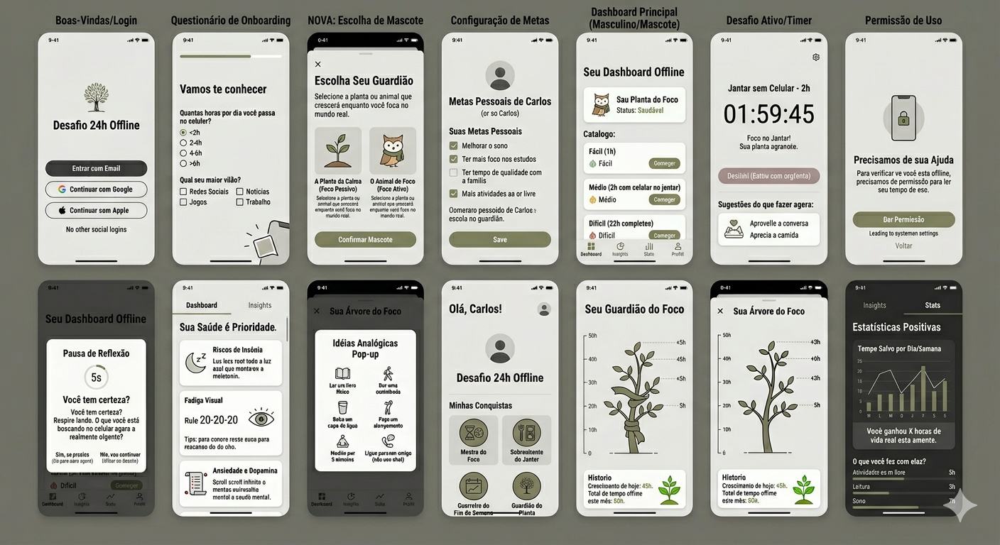

# 📵 Desafio 24h Offline

Um aplicativo minimalista desenvolvido para ajudar pessoas a reduzirem o tempo de tela, promovendo hábitos saudáveis e pausas de reflexão consciente no mundo real.

## 🎯 Proposta do Projeto
O **Desafio 24h Offline** utiliza mecânicas de gamificação saudável, guardiões virtuais (plantas e animais) e métricas de autoavaliação para encorajar os usuários a se desconectarem, sem gerar estímulos viciantes dentro do próprio app.

## 📱 Protótipo e Design de Telas

## 📱 Principais Funcionalidades
- **Autenticação Direta:** Login rápido via E-mail, Google ou Apple (sem atalhos para redes sociais).
- **Onboarding e Metas:** Questionário de dependência e definição de metas pessoais de foco e descanso.
- **Escolha do Guardião:** Seleção de mascotes analógicos (planta ou animal) que evoluem conforme o usuário cumpre metas offline.
- **Catálogo de Desafios:** Níveis Fácil (1h), Médio (Jantar sem celular) e Difícil (24h offline).
- **Intervenções Psicossociais:** Pausa de reflexão (pop-up de 5 segundos ao tentar interromper um desafio) e dicas de hábitos analógicos.
- **Estatísticas Positivas:** Relatório de "Tempo Salvo" e conquistas simbólicas.

## 🛠️ Tecnologias Planejadas
- **Mobile:** React Native (Expo) ou Flutter
- **Monitoramento de Uso:** ScreenTime API (iOS) e UsageStatsManager (Android)
- **Armazenamento:** Local-First (foco em privacidade e LGPD)